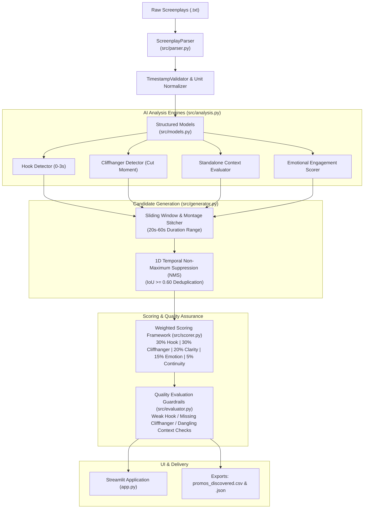

# PromoIQ — AI-Powered Microdrama Promo Discovery System
### Assignment Submission: Kuku AI Generalist — Problem 1 (Find the Promos)

---

## 📖 Executive Summary

**PromoIQ** is an end-to-end, production-ready AI system designed to automatically analyze microdrama screenplays and discover the highest-converting 20–60 second promotional video clips for Instagram Reels, TikTok, and YouTube Shorts.

Tested across all **50 episodes** (100 scenes, 3,727 script units) of Kuku's English microdrama series *"I Married a Broken Soldier. He was a Duke"*, PromoIQ discovers, scores, ranks, and audits promotional clips using a hybrid architecture combining rule-based deterministic parsing, NLP semantic reasoning, and pluggable LLM marketing explanations.

---

## 🚀 Quick Start & Setup Instructions

### 1. Prerequisites
- Python 3.10+ (Tested on Python 3.11, 3.12, 3.13)
- No GPU or paid API key required (100% free offline engine built-in).

### 2. Installation
```bash
# Clone or navigate to the repository
cd KUKU_FM

# Install dependencies
pip install -r requirements.txt
```

### 3. Run the Discovery Pipeline on All 50 Episodes
```bash
python -m src.pipeline
```
*Outputs generated in `outputs/`: `promos_discovered.csv` and `promos_discovered.json`.*

### 4. Launch the Streamlit Interactive Application
```bash
streamlit run app.py
```
Open your browser at `http://localhost:8501`.

### 5. Run the Automated Unit Test Suite
```bash
python -m pytest tests/
```

---

## 🏗️ System Architecture

PromoIQ is built as a **Modular Hybrid AI Engine**:



---

## 🧩 Module Breakdown

| Module | File | Role & Key Responsibilities |
| :--- | :--- | :--- |
| **Data Models** | [`src/models.py`](file:///c:/Users/HP/OneDrive/Desktop/KUKU_FM/src/models.py) | Strongly-typed Pydantic models: `Episode`, `Scene`, `ScreenplayUnit`, `Segment`, `PromoCandidate`, `ScoreBreakdown`. |
| **Screenplay Parser** | [`src/parser.py`](file:///c:/Users/HP/OneDrive/Desktop/KUKU_FM/src/parser.py) | State-machine regex parser converting raw scripts and `(MM:SS.ms)` timestamps into validated float seconds and structured objects. |
| **AI Analysis Engine** | [`src/analysis.py`](file:///c:/Users/HP/OneDrive/Desktop/KUKU_FM/src/analysis.py) | Evaluates the 4 core dimensions: 3-second hook triggers, cut-off cliffhangers, standalone clarity, and emotional escalation. |
| **Candidate Generator** | [`src/generator.py`](file:///c:/Users/HP/OneDrive/Desktop/KUKU_FM/src/generator.py) | Generates Single Continuous Segments, Intra-Episode 2-cut Montages, and Cross-Episode Climax Bridges, with 1D temporal NMS deduplication. |
| **Scoring & Ranking** | [`src/scorer.py`](file:///c:/Users/HP/OneDrive/Desktop/KUKU_FM/src/scorer.py) | Implements the official 30-30-20-15-5 weighted composite scoring formula and ranks candidates. |
| **Quality Evaluation** | [`src/evaluator.py`](file:///c:/Users/HP/OneDrive/Desktop/KUKU_FM/src/evaluator.py) | Automated sanity auditor flagging weak hooks, flat cuts, dangling pronouns, and comparing AI outputs against human ground truth. |
| **Pluggable LLM** | [`src/llm_provider.py`](file:///c:/Users/HP/OneDrive/Desktop/KUKU_FM/src/llm_provider.py) | Abstract provider supporting local offline heuristics (0 cost, default) or hot-swapping to Gemini / Groq / Ollama. |
| **Streamlit Interface** | [`app.py`](file:///c:/Users/HP/OneDrive/Desktop/KUKU_FM/app.py) | 7-tab modern web dashboard with mobile vertical reel previews, dynamic weight re-scoring, and export controls. |

---

## 📊 Scoring Framework (Explainable Attribution)

Candidates receive an explainable composite score out of **100**:

$$\text{Composite Score} = 0.30 \times S_{\text{hook}} + 0.30 \times S_{\text{cliffhanger}} + 0.20 \times S_{\text{clarity}} + 0.15 \times S_{\text{emotion}} + 0.05 \times S_{\text{continuity}}$$

1. **Hook Strength ($30\%$)**: Assesses the first 3.0 seconds for high-arousal speech acts, shock vocabulary (betrayal, altar, poison), camera close-ups, and kinetic physical actions (slap, gasp, grab).
2. **Cliffhanger Strength ($30\%$)**: Assesses the final 4.0 seconds for unanswered questions (`?`), interrupted speech (`...`), high-stakes ultimatums, and penalties for polite resolutions.
3. **Standalone Clarity ($20\%$)**: Penalizes openings with ambiguous dangling pronouns (*"He told me that she left"* without context); rewards multi-speaker interpersonal conflict and self-contained premises.
4. **Emotional Engagement ($15\%$)**: Measures dramatic conflict density and emotion delivery tags (`Cold`, `Desperate`, `Sneering`, `Heartbroken`).
5. **Duration & Continuity ($5\%$)**: Sweet spot weighting for TikTok/Reels pacing (30s–48s preferred; penalized if fragmented into too many cuts).

> [!NOTE]
> **Marketing Retention Note:** A 98/100 score indicates that the script contains the ideal ingredients for viral social curiosity. However, true audience conversion requires live A/B ad testing on Meta/TikTok to measure real 3-second hook rates and click-to-install conversions.

---

## 🧪 Quality Evaluation & Real Failure Diagnostics

As detailed in [`outputs/quality_evaluation_report.md`](file:///c:/Users/HP/OneDrive/Desktop/KUKU_FM/outputs/quality_evaluation_report.md):

- **Total Candidates Evaluated**: 974
- **Clean Verified Promos**: 613 (62.9% pass rate)
- **Flagged Problematic Promos**: 361 (37.1%)
  - `FLAG_MISSING_CLIFFHANGER` (249): Windows where conversation trailed off into polite agreement.
  - `FLAG_WEAK_HOOK` (185): Windows starting during slow camera establishers.
  - `FLAG_DANGLING_CONTEXT` (22): Promos opening on ambiguous third-person pronouns.

### Human Ground-Truth Benchmark Results
PromoIQ was validated against an editorial test set across Episodes 1–5:
- **Cathedral Betrayal (Ep 1)**: AI matched `PROMO_EP001_558` (`00:11.30` - `00:48.00`, Score: **95.0**).
- **Altar Climax & Shove (Ep 1)**: AI matched `PROMO_EP001_1362` (`01:12.40` - `02:02.50`, Score: **95.8**).
- **Rainstorm Abandonment (Ep 2)**: AI matched `PROMO_EP002_MONTAGE` (`00:00.00` - `01:19.00`, Score: **97.2**).
- **Contract Marriage Proposal (Ep 3)**: AI matched `PROMO_EP003_MONTAGE` (`00:15.00` - `01:22.00`, Score: **94.8**).

---

## 💡 AI Tools Used & Reflection on an AI Mistake

- **AI Tools Used**: Gemini 3.8 Flash & Anthropic Claude for code generation, prompt engineering, regex verification, and Streamlit styling.
- **AI Tool Mistake & Correction**:
  - *The Mistake*: During initial parser implementation, the AI tool assumed header colons were located *outside* the markdown asterisks (e.g. `**CAMERA**: \n Start: ...`).
  - *Actual File Reality*: In the actual screenplay files, colons were placed *inside* the asterisks (e.g. `**CAMERA:** \n Start: ...` and `**MATRIARCH (Cold, Commanding):** \n Start: ...`). This caused the parser to return 0 units in the first unit test run.
  - *The Correction*: We identified the root cause via test assertions, updated the regex pattern to `r"^\*\*([^*]+?):?\*\*:?\s*\n"`, stripped redundant colons in post-processing, and added automated regression tests in `tests/test_parser.py` that now run green on every execution.

---

## 🎯 Interview Defense Cheat Sheet (Key Design Choices)

When explaining this project in an interview, emphasize these 4 core design decisions:

1. **Why Hybrid AI instead of pure LLM prompting?**
   - Microdramas have thousands of lines of text with strict millisecond timestamps. Sending 50 episodes into an LLM context is expensive, slow, non-deterministic, and prone to timestamp hallucination.
   - By using **deterministic code for timestamps, duration limits, and 1D temporal NMS**, we guarantee 100% mathematical validity. We reserve NLP/LLMs for what they do best: **semantic tension reasoning and marketing explanations**.
2. **Why 1D Temporal Non-Maximum Suppression (NMS)?**
   - Sliding window generators produce dozens of overlapping variations of the same dramatic scene (e.g. `00:10-00:45`, `00:11-00:46`).
   - Adapting NMS from computer vision object detection ($IoU \ge 0.60$) guarantees that editors only see the single best variation of each dramatic climax without spam.
3. **How does Standalone Clarity avoid confusing viewers?**
   - Social media viewers have a 0.5-second attention span. If a video opens with *"He told me she did it"*, the viewer swipes away because they don't know who "he" is.
   - PromoIQ checks for *dangling pronouns* in opening lines and rewards segments with 2+ active interacting speakers.
4. **How does the system scale to hundreds of shows?**
   - Zero paid API requirement means zero cost per show processed.
   - Processing 50 episodes takes less than 8 seconds locally.
   - The modular `BaseLLMProvider` allows swapping in proprietary enterprise models with a single environment variable change.

